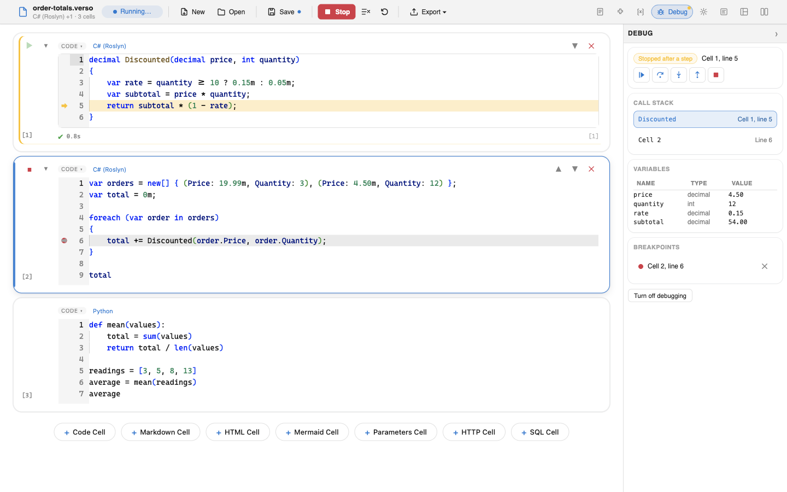

# Debugging Cells

Verso can stop a running cell at a line you choose, show you what its variables hold at that moment, and let you walk through it one line at a time. It works in C# and Python cells, in VS Code and in `verso serve`, and needs nothing installed beyond Verso itself.

## Turning debugging on

Open the **Debug** panel from the panel toggles at the right of the toolbar and press **Turn on debugging**. Cells whose language can be debugged gain a margin beside their line numbers, and the toggle keeps a dot for as long as debugging is on, whether or not the panel is open.

Debugging is a mode of the notebook rather than of one run. Leave it on and every cell you run stops at its breakpoints; turn it off and cells run exactly as they did before. Nothing about it is written into the notebook file.

## Setting a breakpoint

Click in the margin beside a line number. A red dot marks the line, and the cell will stop just before that line runs. Click the dot again to remove it. With the cursor on a line, **F9** does the same from the keyboard.

A breakpoint belongs to its code, not to a line number. Type a new line above one and it moves down with the statement it was set on.

The Debug panel lists every breakpoint in the notebook, in the order the cells appear. Click one to go to its cell, or remove it from there.

A breakpoint on a line that holds no statement of its own, such as a blank line, a comment, or a lone brace, stops at the next statement after it.

## When a cell stops

Run the cell as usual. When it reaches a breakpoint, the line is highlighted, the Debug panel opens, and the cell waits. The panel shows:

- **Where it stopped**, as a cell number and a line.
- **Call stack**: the chain of calls that led there, innermost first. Code that sits outside any function is listed as its cell. Click an entry to go to its cell, where the line it is waiting on is marked in grey.
- **Variables**: the names in scope and their values at that moment. A value is shown as it stands before the highlighted line runs. In Python, clicking an outer entry in the call stack shows that call's variables instead.

From there, the buttons at the top of the panel decide what happens next:

| Button | What it does |
|---|---|
| **Continue** | Runs on to the next breakpoint, or to the end of the cell. |
| **Step over** | Runs the highlighted line, including anything it calls, and stops at the next one. |
| **Step into** | Goes into the function the highlighted line calls and stops at its first line. |
| **Step out** | Runs to the end of the current function and stops back in its caller. |
| **Stop** | Ends the cell where it is, the same as the cell's own stop button. |

You can set and remove breakpoints while a cell is stopped, and they take effect in the same run. Turning debugging off while a cell is stopped lets the cell run on to its end.

## Stepping across cells

A function defined in one cell and called from another can be stepped into: the highlight moves to the cell that defines it, and the call stack shows both. A breakpoint set inside that function stops any cell that calls it.

In Python this works whenever the defining cell has been run. In C#, the defining cell has to have been run while debugging was on, because that is when a C# cell is prepared for stopping. If you turn debugging on partway through a session, run the cells that define what you want to step into once more.

Code that lives outside the notebook, such as a library or a NuGet or pip package, is never stepped into. A step into a line that calls only library code behaves like a step over.

## What to expect

- **Speed.** With debugging off, nothing changes. With it on, a C# cell does a small check before each statement, and Python 3.12 or newer costs nothing measurable away from a breakpoint. On Python 3.8 to 3.11 every line of cell code is reported to the debugger, so a tight loop written in a cell runs noticeably slower while debugging is on. Library code runs at full speed everywhere.
- **Variables.** In C#, the list holds the variables that are definitely assigned at the stopped line, including those earlier cells declared. Inside a function declared in a cell, it holds that function's own parameters and locals. C# reports variables for the call the cell is stopped in only, so an outer entry in the call stack shows where it is waiting but not what it holds. In Python, every call in the stack has its variables, and the cell's own namespace is listed without the modules, functions, and classes it holds, so that the values you are working with are not buried.
- **Values.** A value is shown as short text. Long values are cut, a very large collection is shown from its first few items, and a sequence that would have to be run to be shown, such as a LINQ query, is named rather than enumerated, so looking at it cannot change what the cell does next.
- **One at a time.** One cell is stopped at a time, and a stopped cell counts as a running one. Other cells cannot be run until it finishes or is stopped, and in VS Code anything else that waits its turn behind a running cell, saving the notebook included, waits behind a stopped one too.
- **A C# cell that cannot be stopped.** A few C# constructs cannot be prepared for stopping. Such a cell says so in its output and runs normally.
- **Restarting the kernel** ends a stopped cell first, then restarts. Breakpoints and the debugging mode survive the restart.

## Other languages

A cell can be debugged when its kernel is able to pause itself. C# and Python are the two that ship with Verso. A kernel from an extension gains the margin, the panel, and stepping by implementing one interface; see [IDebuggableKernel](../extensions/extension-interfaces.md#idebuggablekernel).

## See also

- [Language Kernels](language-kernels.md)
- [Comparing Notebooks](comparing-notebooks.md)
